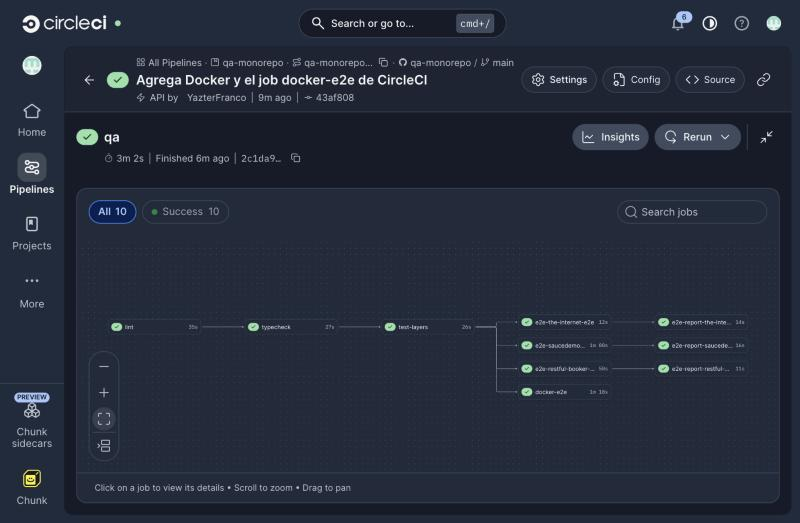

# qa-monorepo

Monorepo de automatización de pruebas. Reúne en un solo lugar los specs de cada producto y las capas que comparten: datos por ambiente, page objects, clientes de API, componentes, acciones de negocio y fixtures.

- **Web y API:** Playwright, con emulación de iPhone y Pixel para la web.
- **App móvil nativa:** Appium con WebdriverIO, sobre Android.
- **Herramientas:** pnpm workspaces y Turborepo, que ejecuta las tareas en orden y no repite las que no cambiaron.

Se cambia de ambiente con una variable (`TEST_ENV`), sin tocar código. Las credenciales nunca están en el repo.

> **Para aprender cómo funciona:** abre en el navegador [docs/flujo.html](docs/flujo.html) (el recorrido interactivo de un test, de los datos y del pipeline) y [docs/curso.html](docs/curso.html) (un curso por carpeta: qué va en cada una y cómo decidirlo). GitHub los muestra como código; descárgalos o ábrelos desde tu copia local con `open docs/curso.html`.

Hoy hay cuatro productos de demostración:

| Producto       | Tipo           | App                                                | Qué prueba                                                                | Tests |
| -------------- | -------------- | -------------------------------------------------- | ------------------------------------------------------------------------- | ----- |
| the-internet   | Web            | [apps/the-internet-e2e](apps/the-internet-e2e)     | Login de [the-internet.herokuapp.com](https://the-internet.herokuapp.com) | 1     |
| saucedemo      | Web            | [apps/saucedemo-e2e](apps/saucedemo-e2e)           | Login, inventario, carrito y checkout, con usuarios que simulan fallas    | 48    |
| restful-booker | API REST       | [apps/restful-booker-api](apps/restful-booker-api) | Token, alta, lectura, búsqueda, actualización y borrado de reservas       | 13    |
| my-demo-app    | Android nativo | [apps/my-demo-app-e2e](apps/my-demo-app-e2e)       | Login y carrito de la app de demo de Sauce Labs en un emulador            | 5     |

Los 16 tests de Sauce Demo corren en 3 perfiles: Chrome de escritorio, Pixel 7 e iPhone 15 emulados (16 × 3 = 48). Además, [tests-of-layers](tests-of-layers) tiene 29 pruebas de las capas, sin navegador ni red.

## Contenido

- [Requisitos](#requisitos) e [instalación](#instalación)
- [Inicio rápido](#inicio-rápido): tu primera corrida y cómo leer el resultado
- [Comandos](#comandos)
- [Correr todo en Docker](#correr-todo-en-docker)
- [Simular dispositivos móviles](#simular-dispositivos-móviles)
- [Trabajar con agentes](#trabajar-con-agentes)
- [Estructura](#estructura)
- [Cómo funciona un test, paso a paso](#cómo-funciona-un-test-paso-a-paso)
- [Dirección de dependencias](#dirección-de-dependencias)
- [¿Dónde va cada cosa?](#dónde-va-cada-cosa)
- [Por qué los datos están fuera del código](#por-qué-los-datos-están-fuera-del-código)
- [Ambientes y credenciales](#ambientes-y-credenciales)
- [Mensajes de error que vas a ver](#mensajes-de-error-que-vas-a-ver)
- [CI](#ci)
- [Problemas comunes](#problemas-comunes)
- [Glosario](#glosario)
- [Decisiones](#decisiones)

## Requisitos

- Node 24 (está en [.nvmrc](.nvmrc)).
- pnpm 12.16.1 (está en `packageManager` de [package.json](package.json)).
- Solo para la app Android: Android SDK con un emulador (por defecto `Pixel_10_Pro`) y Java 17 o más. Detalles en [apps/my-demo-app-e2e](apps/my-demo-app-e2e).
- Opcional: Docker, para correr la suite web y de API sin instalar Node ni navegadores ([Correr todo en Docker](#correr-todo-en-docker)).

## Instalación

```bash
nvm use
npm install --global pnpm@12.16.1
pnpm install
pnpm --filter saucedemo-e2e exec playwright install chromium webkit
```

`pnpm install` también activa los git hooks de Husky. El último comando solo hace falta la primera vez o cuando cambia la versión de Playwright; los navegadores sirven para todas las apps web.

Para la app Android, además, una vez:

```bash
pnpm --filter my-demo-app-e2e app:download
```

## Inicio rápido

Corre las pruebas de API y de the-internet, las más rápidas:

```bash
pnpm turbo run test:e2e --filter=restful-booker-api --filter=the-internet-e2e
```

Salida real, resumida:

```
restful-booker-api:test:e2e: Running 13 tests using 8 workers
restful-booker-api:test:e2e:   ✘   6 [api] › booking.spec.ts:48:7 › crear y leer › crear con datos incompletos responde 400 (615ms)
restful-booker-api:test:e2e:   ✓   4 [api] › booking.spec.ts:10:7 › crear y leer › crear una reserva devuelve su id y los mismos datos (658ms)
restful-booker-api:test:e2e:   ✓   2 [api] › auth.spec.ts:4:5 › admin obtiene un token (704ms)
...
restful-booker-api:test:e2e:   ✘  10 [api] › booking.spec.ts:87:7 › modificar y borrar › actualizar quita los campos que no se mandan (533ms)
restful-booker-api:test:e2e:   13 passed (6.0s)
the-internet-e2e:test:e2e:   ✓  1 [chromium] › login.spec.ts:4:5 › usuario válido inicia sesión (3.0s)
the-internet-e2e:test:e2e:   1 passed (9.2s)

 Tasks:    9 successful, 9 total
Cached:    7 cached, 9 total
```

Cómo leerla:

- **`restful-booker-api:test:e2e:`** es el prefijo de Turbo: qué paquete y qué tarea escribió la línea. Antes de los tests, Turbo corrió el `typecheck` de las capas que usa cada app.
- **`[api]`, `[chromium]`, `[pixel-7]` o `[iphone-15]`** es el proyecto de Playwright: sin navegador (API), Chrome de escritorio o un teléfono emulado.
- **`booking.spec.ts:48:7 › crear y leer › …`** es el archivo, la línea, el `describe` y el nombre del test.
- **`✘` con `13 passed`** no es un error: son los dos bugs conocidos, marcados con `test.fail`. Playwright los muestra con `✘` porque fallaron, y los cuenta como correctos porque se esperaba que fallaran. Si un día pasan, el resumen dice `failed` y hay que quitar el `test.fail`.
- **`Cached: 7 cached`**: Turbo no volvió a correr el `typecheck` de las capas que no cambiaron.

Para ver un test web en acción, con el navegador y cada paso:

```bash
pnpm --filter saucedemo-e2e exec playwright test --ui
```

## Comandos

| Comando             | Qué hace                                                              |
| ------------------- | --------------------------------------------------------------------- |
| `pnpm lint`         | ESLint en todos los paquetes, con las reglas de capas                 |
| `pnpm format`       | Formatea todo con Prettier                                            |
| `pnpm format:check` | Revisa el formato sin cambiar archivos                                |
| `pnpm typecheck`    | TypeScript en modo `strict` en todos los paquetes                     |
| `pnpm test:layers`  | Pruebas de cada capa, sin navegador ni red                            |
| `pnpm test:e2e`     | Specs web y de API contra el ambiente de `TEST_ENV`                   |
| `pnpm test:mobile`  | Specs de Android; necesita el emulador (Appium lo arranca si no está) |

Ejemplos:

```bash
# Otro ambiente: usa libs/test-data/<producto>/environments/qa.json (por defecto: public-demo)
TEST_ENV=qa pnpm test:e2e

# Un solo producto
pnpm turbo run test:e2e --filter=restful-booker-api

# Opciones de Playwright: modo UI, con navegador visible, un archivo, un test por nombre
pnpm --filter saucedemo-e2e exec playwright test --ui
pnpm --filter saucedemo-e2e exec playwright test --headed checkout.spec.ts
pnpm --filter saucedemo-e2e exec playwright test -g "compra completa"

# Un solo perfil: chromium, pixel-7 o iphone-15
pnpm --filter saucedemo-e2e exec playwright test --project=iphone-15

# Abrir el último reporte HTML
pnpm --filter saucedemo-e2e exec playwright show-report

# Un solo archivo de la app Android
pnpm --filter my-demo-app-e2e exec wdio run wdio.conf.ts --spec login.spec.ts
```

## Correr todo en Docker

La imagen del [Dockerfile](Dockerfile) parte de la imagen oficial de Playwright (Node y navegadores de la misma versión), instala pnpm y el monorepo. Sirve para correr la suite sin instalar nada más que Docker, y es la misma que usa el job `docker-e2e` de CircleCI.

```bash
docker compose run --rm qa
```

Ese comando construye la imagen si hace falta (la primera vez tarda unos minutos), corre `pnpm test:layers` y `pnpm test:e2e` (web y API) con [docker/run-tests.sh](docker/run-tests.sh) y deja el reporte en `reporte/`:

```
reporte/
  index.html              resumen: tests, fallidos y tiempo por paquete
  tests-of-layers/        reporte HTML de Playwright y junit.xml
  the-internet-e2e/
  saucedemo-e2e/
  restful-booker-api/
```

Abre `reporte/index.html`. Hay un ejemplo real, generado en CircleCI, en [docs/reporte-ejemplo](docs/reporte-ejemplo).

```bash
# Otro ambiente
TEST_ENV=staging docker compose run --rm qa

# Otro comando dentro de la imagen
docker compose run --rm qa pnpm lint

# Reconstruir la imagen después de cambiar dependencias
docker compose build
```

- La imagen corre con `CI=true`: misma configuración de Playwright que en CircleCI (2 reintentos, reportes blob y JUnit).
- El código se copia al construir la imagen: si cambias un archivo, vuelve a construirla (`docker compose build`, que reutiliza la capa de dependencias).
- La emulación móvil web corre en Docker, porque la imagen trae Chromium y WebKit. La app Android no: su emulador necesita aceleración por hardware.

## Simular dispositivos móviles

En este repo hay dos tipos de prueba móvil:

|               | Emulación móvil web                                                         | App nativa                                   |
| ------------- | --------------------------------------------------------------------------- | -------------------------------------------- |
| Qué prueba    | La página web en la pantalla de un teléfono                                 | La app Android instalada en un dispositivo   |
| Dónde está    | [apps/saucedemo-e2e](apps/saucedemo-e2e), proyectos `pixel-7` e `iphone-15` | [apps/my-demo-app-e2e](apps/my-demo-app-e2e) |
| Con qué corre | Playwright, con Chromium y WebKit                                           | Appium, en un emulador de Android            |
| Dónde corre   | Tu máquina, Docker y CircleCI                                               | Tu máquina, con el emulador                  |

La emulación usa los mismos specs, pages y datos que el escritorio. Playwright le da a cada test la pantalla, la densidad de píxeles, el identificador del navegador y el toque del teléfono, y la página responde como en un móvil: Sauce Demo muestra una sola columna y el filtro como ícono.

```bash
pnpm --filter saucedemo-e2e exec playwright test --project=pixel-7
pnpm --filter saucedemo-e2e exec playwright test --project=iphone-15 --headed
```

No reemplaza a un teléfono real: el perfil de Pixel usa Chromium y el de iPhone, WebKit, el motor de Safari, pero no el Safari de iOS. Tampoco cubre el teclado del sistema ni el rendimiento real del dispositivo.

Cómo agregar otro teléfono: [CONTRIBUTING.md](CONTRIBUTING.md#agregar-un-teléfono-a-la-emulación-móvil).

## Trabajar con agentes

El repo trae plantillas para agentes de código, sin datos personales:

- [AGENTS.md](AGENTS.md): instrucciones para cualquier agente.
- [CLAUDE.md](CLAUDE.md): importa `AGENTS.md` y agrega lo propio de Claude Code.
- [.claude/](.claude): steering por tema, skills, subagentes y permisos.
- [.mcp.json](.mcp.json): el servidor MCP de Playwright.

La guía para usarlas, agregar las tuyas y dónde va tu información personal está en [docs/agentes.md](docs/agentes.md).

## Estructura

```
apps/                    una app por producto: solo specs y su configuración
  the-internet-e2e/
  saucedemo-e2e/
  restful-booker-api/
  my-demo-app-e2e/
libs/                    las capas que comparten todas las apps
  test-data/             cargador común + una carpeta de datos por producto
  pages/<producto>/      un page object (web) o screen (móvil) por pantalla
  api/<producto>/        un cliente por recurso de la API y sus contratos
  components/<producto>/ partes de la interfaz que usan 2 o más pantallas
  steps/<producto>/      acciones de negocio por dominio
  fixtures/<producto>/   arma env y steps para cada spec
  utils/                 configuración base de Playwright
tests-of-layers/         pruebas de cada capa, sin navegador ni red
docker/                  script que corre la suite en Docker y arma el reporte
.circleci/               pipeline de CircleCI
.claude/                 steering, skills, subagentes y permisos para agentes
docs/                    flujo.html, curso.html, agentes.md y un reporte de ejemplo
```

Archivos de la raíz:

| Archivo                                                | Para qué sirve                                                                     |
| ------------------------------------------------------ | ---------------------------------------------------------------------------------- |
| [package.json](package.json)                           | Scripts (`pnpm lint`, `pnpm test:e2e`…), versión de pnpm y reglas de lint-staged   |
| [pnpm-workspace.yaml](pnpm-workspace.yaml)             | Qué carpetas son paquetes y el catálogo de versiones compartidas                   |
| [turbo.json](turbo.json)                               | Tareas, su orden (`dependsOn`), qué se guarda en caché y qué variables pasan       |
| [tsconfig.base.json](tsconfig.base.json)               | TypeScript estricto y los alias (`pages/saucedemo`, `test-data`…)                  |
| [eslint.config.mjs](eslint.config.mjs)                 | Reglas de capas: qué puede importar cada una y dónde no van selectores ni `expect` |
| [.husky/pre-commit](.husky/pre-commit)                 | Corre lint-staged antes de cada commit                                             |
| [Dockerfile](Dockerfile), [compose.yaml](compose.yaml) | Imagen con todo el monorepo para correr la suite igual en tu máquina y en CI       |
| [.circleci/config.yml](.circleci/config.yml)           | El pipeline de CircleCI                                                            |
| `.prettierrc`, `.editorconfig`, `.nvmrc`               | Formato, estilo del editor y versión de Node                                       |

Cada carpeta de `libs/`, `apps/` y `tests-of-layers/` tiene su README con el propósito, las reglas y un ejemplo.

## Cómo funciona un test, paso a paso

Recorrido del test `compra completa de un producto` de [checkout.spec.ts](apps/saucedemo-e2e/checkout.spec.ts), de arriba hacia abajo. En [docs/flujo.html](docs/flujo.html) está el mismo recorrido, interactivo, para web, API y móvil.

**1. El comando.** `pnpm turbo run test:e2e --filter=saucedemo-e2e` hace que Turbo corra primero el `typecheck` de las capas que usa la app (`dependsOn: ["^typecheck"]`) y después `playwright test` dentro de `apps/saucedemo-e2e`.

**2. La configuración.** [playwright.config.ts](apps/saucedemo-e2e/playwright.config.ts) extiende la base de [libs/utils](libs/utils) (reintentos, reporters, trace) y le agrega Chrome y `testIdAttribute: "data-test"`.

**3. El spec** decide el flujo y qué se espera. No tiene selectores ni datos escritos:

```ts
import { expect, test } from "fixtures/saucedemo";

test("compra completa de un producto", async ({ auth, cart, checkout, env, page }) => {
  await auth.loginAs("standard");
  await cart.add(env.products.backpack);

  await checkout.completeOrder(env.customers.standard);

  await expect(new CheckoutCompletePage(page).confirmationTitle).toHaveText(
    env.messages.orderComplete,
  );
});
```

**4. Las fixtures** entregan lo que el test pide entre `{ }`. [fixtures/saucedemo](libs/fixtures/saucedemo/index.ts) crea `auth`, `cart` y `checkout`; [base.fixture.ts](libs/fixtures/base.fixture.ts) carga `env` una vez por worker y usa su `baseUrl` como `baseURL`.

**5. Los datos.** `loadEnvironment("saucedemo")` lee `common/*.json`, le aplica encima `environments/public-demo.json`, reemplaza las `${VAR}` y valida todo con Zod. Así, `env.products.backpack` es `{ "name": "Sauce Labs Backpack", "price": 29.99 }` y `env.users.standard` es el usuario y la contraseña de ese ambiente.

**6. Los steps** traducen cada frase del spec en acciones sobre pantallas. `auth.loginAs("standard")` busca el usuario en `env.users`, abre el login y lo completa:

```ts
async loginAs(role: string): Promise<void> {
  const user = this.environment.users[role]; // si no existe, falla con los roles disponibles
  const loginPage = new LoginPage(this.page);
  await loginPage.goto();
  await loginPage.login(user.username, user.password);
}
```

`checkout.completeOrder(cliente)` abre el carrito, inicia el checkout, llena los datos y confirma, usando cuatro page objects.

**7. Los pages** son los únicos que saben dónde está cada elemento. `LoginPage` sabe que el usuario es `getByTestId("username")`; `InventoryPage.addToCart("Sauce Labs Backpack")` hace clic en `data-test="add-to-cart-sauce-labs-backpack"`.

**8. Los componentes** son bloques que aparecen en varias pantallas. El carrito se abre desde el `Header`, que comparten el inventario, el carrito y el checkout.

**9. La aserción** vuelve al spec: `expect(…confirmationTitle).toHaveText(env.messages.orderComplete)` espera sola hasta que el título dice `Thank you for your order!`.

**10. El resultado.** Una línea `✓` en la consola y, si falla, captura, video y trace en `test-results/`, más el reporte HTML (`playwright show-report`).

En API el recorrido es igual, con un **cliente** de [libs/api](libs/api) en lugar de los pages. En móvil, el spec arma sus steps con `myDemoApp(driver)` y las pantallas usan Appium.

## Dirección de dependencias

```
specs → fixtures → steps → pages | api → components
                     ↓
                 test-data
```

Cada flecha dice quién conoce a quién: un spec usa fixtures, una fixture crea steps, un step usa pages o clientes de API, y un page usa componentes. Ninguna capa conoce a la de arriba.

Hay una excepción a propósito: el spec también lee **propiedades de los pages** (`new CheckoutCompletePage(page).confirmationTitle`) y **esquemas de la API** (`parseBody(respuesta, tokenSchema)`) para hacer sus aserciones. Lo que no hace es buscar elementos ni escribir datos.

ESLint lo hace cumplir: falla si, por ejemplo, un page importa un step, si un spec usa un selector (`getBy*`, `locator`, `$`) o si un page object hace una aserción. Las reglas están en [eslint.config.mjs](eslint.config.mjs); ver [Mensajes de error](#mensajes-de-error-que-vas-a-ver).

Cada capa se importa por producto (`pages/saucedemo`, `api/restful-booker`), gracias a los alias de [tsconfig.base.json](tsconfig.base.json). Lo que comparten todos los productos se importa sin subruta: `test-data`, `utils` y `components`.

Web, API y móvil comparten los datos (`test-data`), las reglas de capas y el formato de los steps. Lo que cambia es la herramienta debajo: Playwright `Page` en web, Playwright `request` en API y una sesión de Appium en móvil.

## ¿Dónde va cada cosa?

La pregunta que decide la carpeta es: **¿qué cambio me obligaría a editar esto?**

| Si cambia…                                  | Se edita…                            | Ejemplo                                              |
| ------------------------------------------- | ------------------------------------ | ---------------------------------------------------- |
| el ambiente (URL, usuarios)                 | `test-data/<producto>/environments`  | `baseUrl` de staging, el usuario `standard`          |
| un texto, producto o cliente igual en todos | `test-data/<producto>/common`        | `messages.json`: `"Thank you for your order!"`       |
| una contraseña o token real                 | un secreto del CI, como `${VAR}`     | `"password": "${STAGING_STANDARD_PASSWORD}"`         |
| el HTML o la pantalla de la app             | `pages/<producto>`                   | `getByTestId("login-button")`                        |
| un bloque que se repite en varias pantallas | `components/<producto>`              | el `Header` con el carrito y el menú                 |
| un endpoint, un método HTTP o una cabecera  | `api/<producto>/<recurso>.client.ts` | `PUT /booking/:id` con el token en la cookie         |
| la forma de una respuesta de la API         | `api/<producto>/schemas.ts`          | `bookingResponseSchema`                              |
| los pasos de un proceso de negocio          | `steps/<producto>`                   | `completeOrder`: carrito → datos → confirmar         |
| qué objetos recibe cada test                | `fixtures/<producto>`                | registrar `CheckoutSteps` como `checkout`            |
| qué se considera correcto                   | el spec en `apps/<producto>-e2e`     | `expect(...).toHaveText(env.messages.orderComplete)` |
| reintentos, reporters, navegadores          | `utils/playwright.base.ts`           | `retries: isCI ? 2 : 0`                              |

Dos casos que confunden:

- **No todo dato va a `test-data`.** Si el valor _es_ el escenario, se queda en el spec. En `sin nombre no avanza y lo pide`, el campo vacío (`{ ...env.customers.standard, firstName: "" }`) es lo que se prueba; el cliente base sale de los datos.
- **Un locator que usa una sola pantalla no es un componente.** Se queda en su page hasta que una segunda pantalla lo necesite.

El curso ([docs/curso.html](docs/curso.html)) tiene una lección por carpeta y un ejercicio para practicar estas decisiones.

## Por qué los datos están fuera del código

Ningún spec, step ni page tiene una URL, un usuario o un texto esperado escrito. Todo está en `libs/test-data`. Beneficios:

1. **Cambiar de ambiente sin tocar código.** `TEST_ENV=staging` usa `environments/staging.json`; los specs son los mismos.
2. **Un cambio, un solo lugar.** Si Sauce Demo cambia `Thank you for your order!`, se edita `common/messages.json` y no cada spec que lo revisa.
3. **Secretos fuera del repo.** El archivo dice `${STAGING_STANDARD_PASSWORD}`; el valor llega desde el CI. Si falta, la carga falla con el nombre de la variable y sin mostrar valores.
4. **Errores antes de abrir el navegador.** Zod valida cada archivo al cargarlo: una URL mal escrita o un `common/costumers.json` con error de tipeo fallan en milisegundos, con un mensaje claro, y no a mitad de un test.
5. **Specs que se leen como negocio.** `auth.loginAs("lockedOut")` dice qué se prueba; `"locked_out_user"` y `"secret_sauce"` no.
6. **Capas que se prueban solas.** Pages y steps reciben los datos como parámetro, así que `tests-of-layers` los prueba con datos inventados, sin red.
7. **El mismo mecanismo para web, API y móvil.** Los cuatro productos usan el mismo cargador y las mismas reglas.

El costo: una indirección más (hay que abrir el JSON para saber qué es `env.products.backpack`) y mantener las claves al día. Un ejemplo de ese acoplamiento: el test de orden de [inventory.spec.ts](apps/saucedemo-e2e/inventory.spec.ts) espera ver exactamente los precios de `common/products.json`, así que ese archivo debe listar el catálogo completo.

## Ambientes y credenciales

- `TEST_ENV` elige el archivo `libs/test-data/<producto>/environments/<ambiente>.json`. Por defecto es `public-demo`.
- Ese archivo se combina con `libs/test-data/<producto>/common/*.json`, que guarda lo que no cambia entre ambientes. Si una clave está en los dos, gana el ambiente.
- Las credenciales se escriben como `${VAR}` y se resuelven desde variables de entorno o desde los secretos del CI. Si falta una variable, la carga falla con su nombre, sin mostrar valores.
- Turbo solo pasa a las tareas las variables declaradas. Cada variable nueva va en `passThroughEnv` de `test:e2e` (o `test:mobile`) en [turbo.json](turbo.json).
- Las credenciales de `public-demo` están escritas en el repo porque son las públicas de cada demo.

Ejemplo de un ambiente nuevo, `libs/test-data/saucedemo/environments/staging.json`:

```json
{
  "baseUrl": "https://staging.example.com",
  "users": {
    "standard": { "username": "qa.standard", "password": "${STAGING_STANDARD_PASSWORD}" }
  }
}
```

```bash
STAGING_STANDARD_PASSWORD=... TEST_ENV=staging pnpm turbo run test:e2e --filter=saucedemo-e2e
```

Detalles en [libs/test-data/README.md](libs/test-data/README.md).

## Mensajes de error que vas a ver

Los mensajes del repo están en español y dicen qué hacer. Estos son reales:

**Una capa importa a otra de arriba** (un page que importa un step):

```
libs/pages/saucedemo/demo.page.ts
  1:1  error  'steps/saucedemo' import is restricted from being used by a pattern. Una capa inferior no conoce a la superior (specs → fixtures → steps → pages | api → components)  no-restricted-imports
```

**Un spec busca un elemento** (`page.getByTestId(...)` en un spec):

```
apps/saucedemo-e2e/demo.spec.ts
  4:9  error  Los selectores van en los page objects  no-restricted-syntax
```

**El ambiente no existe** (`TEST_ENV=staging` sin el archivo):

```
Error: No existe el ambiente "staging" de "the-internet". Disponibles: public-demo.
   at ../../libs/test-data/loader.ts:41
```

**Otros que da el código:**

- `Falta la variable de entorno STAGING_STANDARD_PASSWORD.`
- `El ambiente no tiene un usuario con rol "admn". Roles disponibles: admin, invalid.`
- `El ambiente "public-demo" de "saucedemo" no cumple el esquema:`, seguido del detalle de Zod.
- `La respuesta de https://…/booking/1 no cumple el contrato:`, seguido del detalle de Zod.
- `El ambiente de "my-demo-app" no tiene baseUrl.`, si una fixture web o de API usa un producto sin URL.

## CI

El pipeline está en [.circleci/config.yml](.circleci/config.yml) y corre en [CircleCI](https://app.circleci.com/pipelines/github/YazterFranco/qa-monorepo) con cada push a GitHub. Usa el plan gratis de CircleCI, que da 30,000 créditos al mes y sirve para repos privados.

```
lint → typecheck → test-layers ─┬→ e2e-<producto> (×3, 2 shards cada uno) → e2e-report-<producto> (×3)
                                └→ docker-e2e
```

| Job              | Dónde corre          | Qué hace                                                                    | Qué deja                                          |
| ---------------- | -------------------- | --------------------------------------------------------------------------- | ------------------------------------------------- |
| `lint`           | `cimg/node`          | ESLint con las reglas de capas y Prettier                                   | —                                                 |
| `typecheck`      | `cimg/node`          | TypeScript en todos los paquetes                                            | —                                                 |
| `test-layers`    | `cimg/node`          | Las 29 pruebas de capas                                                     | Resultados en la pestaña Tests                    |
| `e2e-<producto>` | imagen de Playwright | Las pruebas de un producto, repartidas en 2 máquinas                        | JUnit, `test-results/` y un blob por máquina      |
| `e2e-report-…`   | `cimg/node`          | Une los blobs en un HTML; corre aunque fallen los e2e                       | `playwright-report/` como artefacto               |
| `docker-e2e`     | máquina con Docker   | Construye la imagen del [Dockerfile](Dockerfile) y corre capas y e2e dentro | `reporte/` con `index.html` y un HTML por paquete |

**Resultado real:** el primer pipeline pasó los 10 jobs en 3 minutos (59 tests). El reporte completo y las capturas de la corrida están en [docs/reporte-ejemplo](docs/reporte-ejemplo). Desde que se agregó la emulación móvil, la suite tiene 91 tests.



Para conectar otro fork o rehacer la conexión, una sola vez:

1. Entra a [app.circleci.com](https://app.circleci.com) con **Log in with GitHub** y autoriza a CircleCI.
2. En **Projects**, pulsa **Set up** en `qa-monorepo`, elige usar el `.circleci/config.yml` del repo, rama `main`, y pulsa **Set Up Project**. Eso corre el primer pipeline.

Hoy no hace falta ningún secreto: las demos son públicas. Cuando un ambiente use `${VAR}`, crea el context `qa-e2e` (Organization Settings → Contexts), agrégalo a los jobs `e2e` y `docker-e2e` y declara la variable en `passThroughEnv` de `turbo.json`; en `docker-e2e`, pásala también al contenedor con `--env`.

La emulación móvil web corre dentro de `e2e-saucedemo-e2e` y `docker-e2e`. La app Android no corre en CI: su emulador necesita aceleración por hardware, que no existe dentro de Docker.

## Problemas comunes

| Síntoma                                                         | Causa y solución                                                                                                        |
| --------------------------------------------------------------- | ----------------------------------------------------------------------------------------------------------------------- |
| `Executable doesn't exist` al abrir un navegador                | Faltan los navegadores: `pnpm --filter saucedemo-e2e exec playwright install chromium webkit`                           |
| `No existe el ambiente "…"`                                     | `TEST_ENV` apunta a un archivo que no está en `environments/`. Revisa el nombre o créalo                                |
| `Falta la variable de entorno …`                                | Defínela al correr. En CI: agrégala al context `qa-e2e` y a `passThroughEnv` en `turbo.json`                            |
| `El ambiente no tiene un usuario con rol "…"`                   | El rol tiene un error de tipeo o falta en `users` del ambiente; el mensaje lista los que hay                            |
| ESLint: `Una capa inferior no conoce a la superior`             | El código está en la capa equivocada. Revisa [¿Dónde va cada cosa?](#dónde-va-cada-cosa) antes de desactivar la regla   |
| ESLint: `Los selectores van en los page objects`                | Mueve el `getBy*`, `locator` o `$` a un page y exponlo como propiedad                                                   |
| Un test sale con `✘` pero el resumen dice `passed`              | Es un bug conocido con `test.fail`; está bien                                                                           |
| El commit se detiene en el hook                                 | ESLint encontró un error que no puede corregir solo; el mensaje dice el archivo y la línea                              |
| Móvil: no encuentra `app/my-demo-app.apk`                       | Bájalo: `pnpm --filter my-demo-app-e2e app:download`                                                                    |
| Móvil: `instrumentation process is not running` a mitad del run | El servidor de UiAutomator2 se cayó en el emulador. Reinicia el emulador en frío y vuelve a correr                      |
| Móvil: aparece "This app isn't 16 KB compatible"                | Es un aviso del sistema; los steps lo cierran. Si una pantalla nueva no lo cierra, usa `CompatibilityDialog` en su step |

## Glosario

| Término            | Qué es en este repo                                                                                      |
| ------------------ | -------------------------------------------------------------------------------------------------------- |
| Spec               | Archivo `*.spec.ts` en `apps/`: un flujo de negocio y lo que se espera de él                             |
| Page object        | Clase que conoce una pantalla web: dónde está cada elemento y cómo se usa. En móvil se llama _screen_    |
| Componente         | Bloque de interfaz que aparece en 2 o más pantallas, como el encabezado                                  |
| Cliente de API     | Clase que sabe llamar a los endpoints de un recurso (`BookingClient`)                                    |
| Contrato           | Esquema Zod de una respuesta de API: qué campos trae y de qué tipo                                       |
| Step               | Acción de negocio que combina pantallas o llamadas: `loginAs`, `completeOrder`, `bookings.create`        |
| Fixture            | Lo que Playwright entrega a cada test entre `{ }`: `env`, `page`, `auth`…                                |
| Worker             | Proceso de Playwright que corre tests en paralelo; `env` se carga una vez por worker                     |
| Ambiente           | Un archivo de `environments/`: URL y usuarios de `public-demo`, `staging`, etc.                          |
| `${VAR}`           | Referencia a una variable de entorno; se reemplaza al cargar los datos                                   |
| Aserción web-first | `await expect(locator).toHaveText(...)`: reintenta sola hasta que se cumple o vence el tiempo            |
| `test.fail`        | Marca un test que describe el comportamiento correcto de algo que hoy tiene un bug                       |
| Locator            | Forma de encontrar un elemento: `getByRole`, `getByLabel`, `getByTestId`                                 |
| `data-test`        | Atributo que Sauce Demo pone a sus elementos; en apps propias se acuerda un `data-testid` con desarrollo |
| Accessibility id   | El equivalente Android de un `data-testid` (`~View menu`)                                                |
| Shard              | Una parte de los tests; en CI cada app se reparte en 2 máquinas                                          |
| Proyecto           | Una forma de correr los tests en Playwright: `chromium`, `pixel-7`, `iphone-15` o `api`                  |
| Emulación móvil    | Correr la web con la pantalla, el toque y el navegador de un teléfono, sin un teléfono real              |
| Blob report        | Reporte parcial de un shard; el job `e2e-report` los une en un HTML                                      |
| Artefacto          | Archivo que un job de CircleCI guarda para verlo después, como `reporte/` de `docker-e2e`                |
| Imagen de Docker   | Sistema empaquetado con Node, navegadores y el monorepo instalado; se construye con el `Dockerfile`      |
| Page simulada      | `createFakePage()` en `tests-of-layers`: registra las acciones en vez de abrir un navegador              |
| Caché de Turbo     | Si los archivos de una tarea no cambiaron, Turbo repite su resultado sin volver a correrla               |

## Decisiones

| Tema                | Decisión                                                                                   |
| ------------------- | ------------------------------------------------------------------------------------------ |
| Productos           | Una app por producto en `apps/` y una subcarpeta por producto en cada capa                 |
| Locators            | Dentro del page object; pasan a `components` solo si se usan en 2 o más lugares            |
| Selectores          | Web: `getByRole`, `getByLabel` o `data-testid`. Android: accessibility id o resource-id    |
| Contratos de API    | Cada respuesta se valida con un esquema Zod antes de usarla                                |
| Nombres de datos    | Por ambiente (`environments/`) o por dominio (`common/`), nunca por uso                    |
| Nombres de paquetes | Sin prefijos ni `src`; se importan por alias                                               |
| Bugs conocidos      | El test describe el comportamiento correcto y se marca con `test.fail`                     |
| TypeScript          | 6.0, porque typescript-eslint todavía no soporta la 7                                      |
| Gestor de paquetes  | pnpm, con workspaces y catálogo de versiones; uv no aplica (ver abajo)                     |
| Móvil web           | Emulación con los perfiles de Playwright, sin specs aparte; iPhone con 2 workers           |
| Docker              | La imagen de Playwright de la misma versión, con el monorepo instalado; sin la app Android |

### ¿Y uv?

[uv](https://docs.astral.sh/uv/) es el gestor de paquetes y entornos de **Python**. Este repo es TypeScript, y ese papel lo cumple pnpm: instala las dependencias desde `pnpm-lock.yaml`, une los paquetes del workspace y fija versiones con el catálogo. Agregar uv solo tendría sentido si se suma código Python, por ejemplo una suite de pruebas de API con pytest; en ese caso viviría en su propia carpeta, con su `pyproject.toml` y su `uv.lock`, y se instalaría también en la imagen de Docker.

## Contribuir

Cómo agregar un page, un cliente de API, un step, un ambiente o un producto: [CONTRIBUTING.md](CONTRIBUTING.md).

Si cambias una regla, un comando o una carpeta, actualiza también el README de esa carpeta y, si aplica, [docs/flujo.html](docs/flujo.html) y [docs/curso.html](docs/curso.html).
