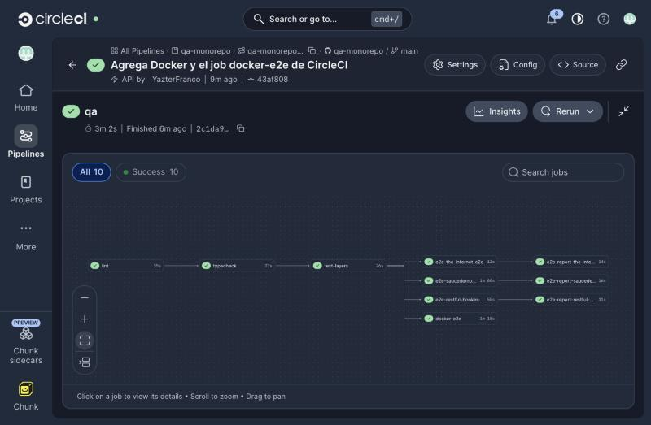
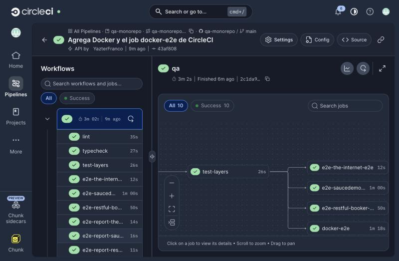
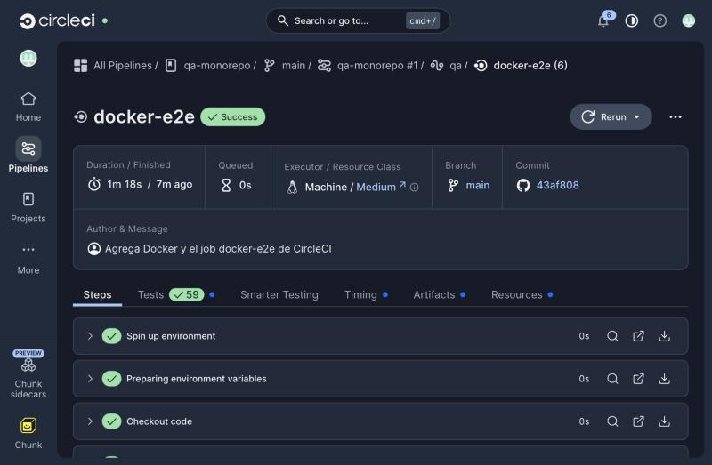
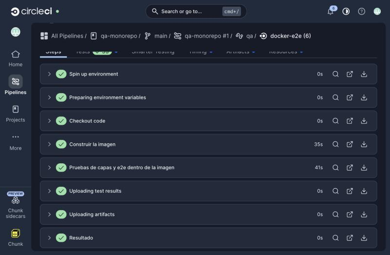
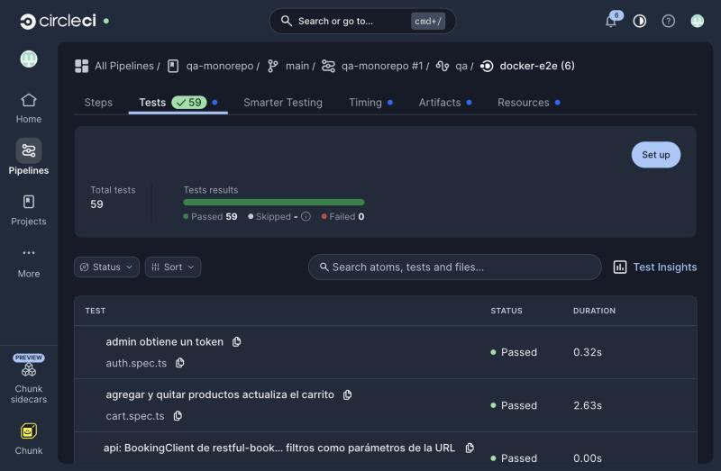
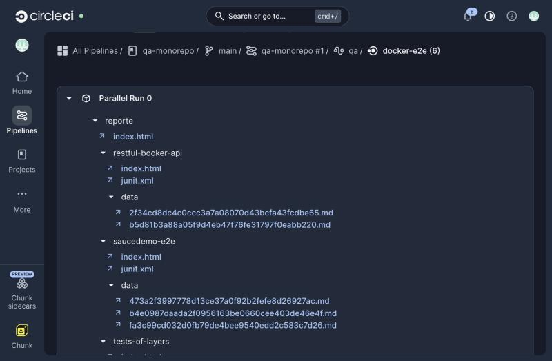
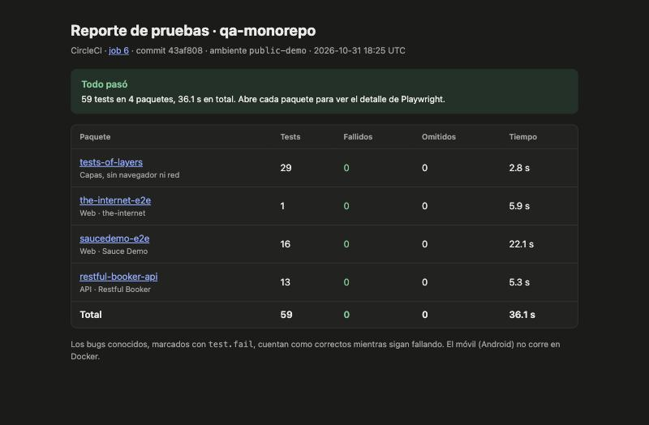
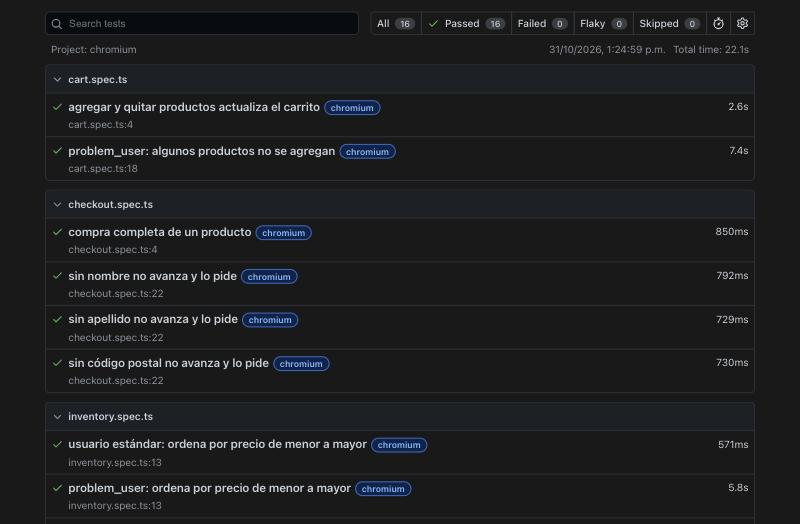
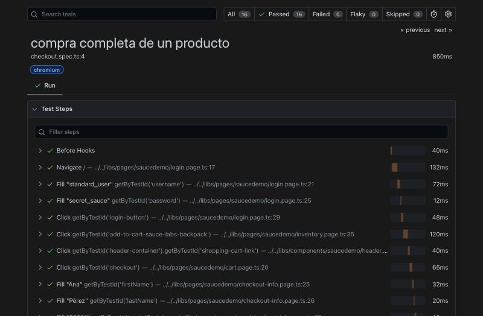

# Reporte de ejemplo: pipeline #1 de CircleCI

Resultado real del primer pipeline de `qa-monorepo` en CircleCI, el 31 de octubre de 2026, sobre el commit `43af808` de `main`. Pasaron los 10 jobs en 3 minutos.

Los archivos de esta carpeta son una copia exacta de los artefactos del job `docker-e2e` (#6): cada uno se verificó con SHA-256 contra el original. Para verlos, clona el repo y abre [index.html](index.html) en el navegador (GitHub los muestra como código).

## Qué hay aquí

```
index.html                 resumen: 59 tests en 4 paquetes, 0 fallidos
tests-of-layers/           reporte de Playwright (29 tests) y junit.xml
the-internet-e2e/          reporte (1 test) y junit.xml
saucedemo-e2e/             reporte (16 tests), junit.xml y data/
restful-booker-api/        reporte (13 tests), junit.xml y data/
capturas/                  la corrida en CircleCI y los reportes
```

Los archivos `data/*.md` son el contexto de error que guarda Playwright para los 5 bugs conocidos (`test.fail`): 3 de Sauce Demo y 2 de Restful Booker. Esos tests fallan a propósito y cuentan como correctos.

## La corrida

| Job                      | Duración   | Tests | Qué hizo                                              |
| ------------------------ | ---------- | ----- | ----------------------------------------------------- |
| `lint`                   | 35 s       | —     | ESLint con las reglas de capas y Prettier             |
| `typecheck`              | 27 s       | —     | TypeScript en los 12 paquetes                         |
| `test-layers`            | 26 s       | 29    | Pruebas de capas, sin navegador                       |
| `e2e-the-internet-e2e`   | 12 s       | 1     | Playwright en 2 máquinas (shards)                     |
| `e2e-saucedemo-e2e`      | 1 min      | 16    | Playwright en 2 máquinas                              |
| `e2e-restful-booker-api` | 50 s       | 13    | Playwright sin navegador, en 2 máquinas               |
| `e2e-report-*` (×3)      | 11–16 s    | —     | Une los reportes de los shards                        |
| `docker-e2e`             | 1 min 18 s | 59    | Construye la imagen (35 s) y corre todo dentro (41 s) |

Los tiempos son de la interfaz de CircleCI. El plan gratis de CircleCI alcanza de sobra para este pipeline.

## Capturas

**El workflow:** `lint → typecheck → test-layers`, y después los e2e por producto, sus reportes y `docker-e2e` en paralelo.





**El job `docker-e2e`:** corre en una máquina con Docker (`Machine / Medium`). Construye la imagen del `Dockerfile` y corre `docker/run-tests.sh` dentro.





**La pestaña Tests:** CircleCI lee los `junit.xml` y muestra los 59 tests.



**Los artefactos:** la carpeta `reporte/` que se copió aquí.



**El resumen** (`index.html`) y un reporte de Playwright, abiertos desde los artefactos:





**El detalle de un test** muestra cada paso y el archivo de la capa que lo hizo: el login en `login.page.ts`, el carrito en `inventory.page.ts` y en el componente `Header`, los datos del cliente en `checkout-info.page.ts`.



## Cómo generar uno igual

En tu máquina, con Docker:

```bash
docker compose run --rm qa
open reporte/index.html
```

En CircleCI, cada push a GitHub corre el pipeline; el reporte queda en los artefactos del job `docker-e2e`.
